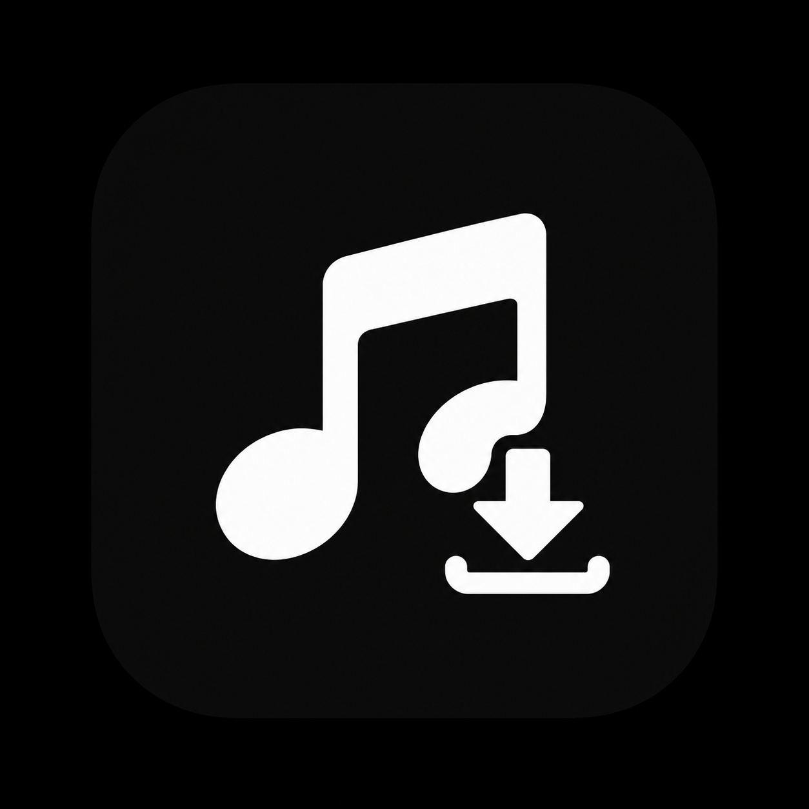

<p align="center">
  
</p>

# Gamdl Desk

A small native macOS app (SwiftUI) that puts a window around [gamdl](https://github.com/glomatico/gamdl), the Apple Music downloader CLI.

Paste Apple Music links, pick codecs and an output folder, and press **Download** (⌘↩). Each finished song or video shows up in the Activity list, and gamdl's full output is in the Log.

## Features

- **Link checking as you paste**: Apple Music links (album, song, playlist, artist, music video) and ISRC codes are counted. Duplicates are ignored, and anything else is flagged and never passed to gamdl.
- **Activity list**: shows what was saved, skipped or failed, with Show in Finder for each file. The status bar shows elapsed time and totals.
- **Fast log**: copy it, save it, or search it with ⌘F. It stays responsive with tens of thousands of lines.
- **Sign-in help**: shows whether gamdl is signed in. If it can't sign in, a banner offers to run `gamdl auth` in Terminal and confirms when it worked. You can also point the app at a `cookies.txt`.
- **Folders & file names**: choose how downloads are arranged: Artist / Album, Artist / Year - Album, Artist - Album, Album, Artist, or no folders at all. File names can be "01 Title", "Title", "Artist - Title" or "01 Artist - Title". Custom mode lets you write gamdl templates yourself. A live preview shows example paths, and invalid templates are flagged before you download.
- **Codec help**: codecs have plain names. ALAC (lossless) is marked as needing gamdl's Wrapper, with a warning and a setup link when you aren't signed in through Wrapper. If Apple refuses an ALAC key, a banner explains why and offers to switch to AAC.
- **Music videos on/off**: turning off "Download music videos" skips music-video links and makes artist links download albums only. gamdl can't leave out videos that are part of an album or playlist, so those still download.
- **Artist links**: choose what an artist link downloads (all albums, singles, top songs, music videos, …) instead of hitting gamdl's interactive menu.
- **Safe stopping**: Stop (⌘.) escalates from interrupt to terminate to kill if gamdl doesn't exit. Quitting during a download asks first and stops gamdl, so it isn't left running.
- **Adapts to window size**: works from a compact 520 pt window up to full screen. The Options inspector can be hidden (⌥⌘I), and it follows light and dark mode.
- The Dock icon bounces and gets a badge when a download finishes in the background.

## Requirements

- macOS 14 or later, Apple Silicon
- Xcode or the Xcode command-line tools (Swift 6)
- gamdl 4.x:
  ```bash
  uv tool install "gamdl[widevine]"
  ```
  The app looks for `gamdl` in `~/.local/bin`, `/opt/homebrew/bin` and `/usr/local/bin`.
- An Apple Music subscription

## Build

```bash
./build.sh
```

This produces `Gamdl Desk.app` next to the script. Drag it to `/Applications`. The app icon is generated from `Assets/logo.png` by `scripts/make-icon.swift`.

## Test

```bash
swift test
```

Covers link parsing, command-line building, settings persistence, gamdl output parsing, and the process runner (streaming, ordering, stdin closed, stop escalation, hung pipes) using real child processes.

## Sign in

gamdl needs to sign in before it can download. Do one of these:

- Click **Sign In with Terminal…** (in Options, or the banner that appears after a sign-in error). It runs `gamdl auth` in Terminal, which asks a few questions. The app waits for it and confirms when you're signed in, or tells you if it didn't finish.
- Or choose a Netscape `cookies.txt` exported from music.apple.com while signed in (it must contain the `media-user-token` cookie).

## Lossless (ALAC) and Dolby Atmos

With cookies or a media user token, gamdl can download **AAC** and **Dolby Atmos**. For **ALAC** (Lossless and Hi-Res), Apple refuses the decryption key, and every song fails with `DrmLicenseError` (checked with gamdl 4.0.2). gamdl doesn't fall back to AAC.

Lossless needs gamdl's **Wrapper** sign-in, which talks to a separately running [Wrapper v2](https://github.com/glomatico/wrapper-v2) service. Wrapper v2 runs Apple Music's Android libraries in a Linux Docker container (arm64 works on Apple Silicon); you supply the Apple Music Android APK yourself and build it locally. Once it's running (default `http://127.0.0.1`, decrypt port 10020), click **Sign In Again…** in Options and choose Wrapper in gamdl's sign-in wizard. The Account status then shows "Signed in · wrapper", and ALAC downloads use it.

## Options

| Section | Settings |
| --- | --- |
| Output | output folder |
| Folders & file names | folder layout, file naming, custom templates, name length limit, live preview |
| Account | cookies file (optional), sign in with Terminal |
| Songs | codec (aac, aac-he, alac, atmos, …), lyrics file and its format |
| Music videos | download music videos on/off, codec (h264/h265), container (m4v/mp4), max height |
| Artist links | what to download from an artist page |
| Files | save cover art (jpg/png), save playlist `.m3u`, overwrite existing files |
| Performance | parallel downloads (1–8) |

Options → Account shows whether gamdl is signed in (and how). It re-checks whenever you switch back to the app, so a `gamdl auth` you run yourself is picked up too. A saved sign-in can still expire later; a download then reports it and offers to sign in again.

### Folder layouts

gamdl saves each file at `output folder / folder template / file template`. The presets set gamdl's eight `--…-template` options (album, compilation, no-album and playlist folders and file names). **No folders** saves everything directly in the output folder. gamdl always needs at least one folder level, so the app passes the output folder's parent as `--output-dir` and the folder's own name as the folder template. For that reason the output folder's name can't contain characters gamdl would replace (`: / \ ? * < > | "`), and can't start or end with a dot.

In **Custom** mode, templates use gamdl's fields, such as `{album_artist}`, `{album}`, `{artist}`, `{title}`, `{track:02d}`, `{disc}`, `{date:%Y}`, `{composer}` and `{playlist_title}`, with `/` for subfolders. The full list is under "Template fields" in the app. The preview renders paths the way gamdl does; the tests compare it against gamdl's own formatter output.

Settings are remembered between launches. Anything not exposed here can be set in gamdl's own config at `~/.gamdl/config.yml`.

## Project layout

| Path | What |
| --- | --- |
| `Sources/GamdlCore` | Testable logic: options → command line, path templates and preview, link parsing, output parsing, process runner |
| `Sources/GamdlDesk` | The SwiftUI app |
| `Tests/GamdlCoreTests` | Swift Testing suite |
| `scripts/make-icon.swift` | Builds `AppIcon.icns` from the logo |

## Credits

All downloading is done by [gamdl](https://github.com/glomatico/gamdl) by glomatico. This app only builds the command line and shows its output.

## License

[MIT](LICENSE)
